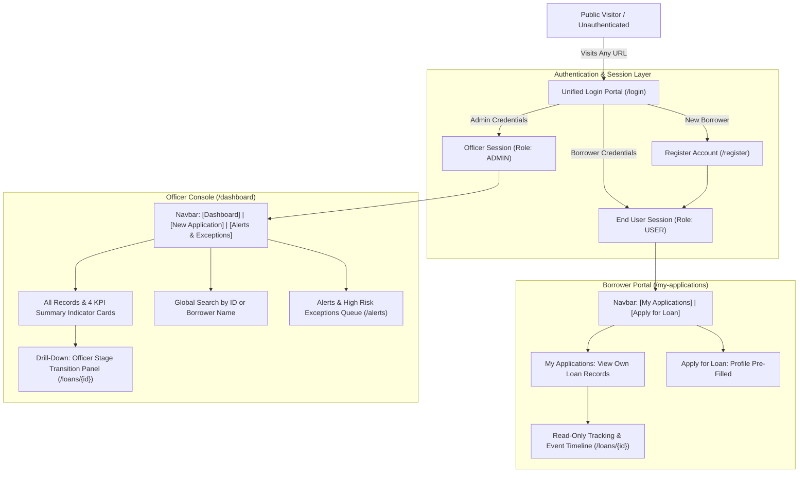
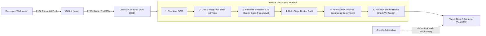

# 🏦 Secure CI/CD Pipeline for a Loan Application Tracking Portal

[]()
[]()
[]()
[]()
[]()
[]()
[]()
[]()

An enterprise-grade financial software portal designed to track, manage, and audit retail loan applications in real-time. Features **dual-role role-based access control (RBAC)** separating **Borrowers (End Users)** and **Bank Loan Officers (Admins)**, backed by a fully automated, hardened, and observable **DevOps CI/CD delivery pipeline**.

---

## 📌 Table of Contents
- [Executive Overview](#-executive-overview)
- [Role-Based Architecture & Portal Separation](#-role-based-architecture--portal-separation)
- [Route Security & Unauthenticated Guard Matrix](#-route-security--unauthenticated-guard-matrix)
- [Pre-Seeded Demo Credentials & Quick Login](#-pre-seeded-demo-credentials--quick-login)
- [End-to-End DevOps Architecture](#-end-to-end-devops-architecture)
- [Key Features](#-key-features)
- [Port Isolation Matrix](#-port-isolation-matrix)
- [Technology Stack](#-technology-stack)
- [CI/CD Pipeline as Code (Jenkinsfile)](#-cicd-pipeline-as-code-jenkinsfile)
- [Automated Quality Gate (Selenium E2E Journeys)](#-automated-quality-gate-selenium-e2e-journeys)
- [Local Quick Start Guide](#-local-quick-start-guide)
- [Configuration Management & Reliability (Ansible)](#-configuration-management--reliability-ansible)
- [Documentation Index](#-documentation-index)
- [Author & Academic Credentials](#-author--academic-credentials)

---

## 🚀 Executive Overview

Traditional retail loan processing suffers from opacity, long turnaround times, and lack of separation between customer submission and underwriting workflows. 

This project addresses these operational challenges with:
1. **Application Layer:** A secure, high-performance web portal built with **Spring Boot 3.2**, **Thymeleaf**, and an embedded **H2 Database**:
   * **Borrower Portal:** End users log in or register to submit loan applications and track their application progress and audit timeline in real time.
   * **Officer Console:** Loan officers and underwriters log in to review all applications across the organization, evaluate CIBIL and FOIR risk parameters, advance application stages, and record timestamped audit notes.
   * **Unauthenticated Access Protection:** Internal dashboards, application forms, and exception queues are strictly hidden and guarded prior to authentication.
2. **DevOps Delivery Layer:** Zero-touch automation utilizing **Git**, **Jenkins Declarative Pipelines**, **Headless Selenium WebDriver UI quality gates (9 journeys)**, **Docker multi-stage containerization**, and **Ansible idempotent configuration management** with sub-15-second disaster recovery rollback.

---

## 👥 Role-Based Architecture & Portal Separation



### 1. End User (Borrower) Capabilities
* **Account Registration & Login:** Create personal credentials via `/register` or log in via `/login`.
* **Personalized Dashboard (`/my-applications`):** View only loans submitted by the logged-in applicant.
* **Auto-Filled Loan Intake (`/apply`):** Applicant's name, email, and phone number are automatically populated from their profile.
* **Status & Stage Tracking (`/loans/{id}`):** Real-time visibility into the loan's current stage (`SUBMITTED`, `DOCUMENT_VERIFIED`, `UNDERWRITING`, `APPROVED`, `REJECTED`) and SBI risk tag (`PRE_APPROVED`, `MANUAL_REVIEW`, `HIGH_RISK_EXCEPTION`).
* **Read-Only Audit Timeline:** The administrative stage-advancement form is hidden and protected from applicants.
* **Strict Isolation:** Cannot access `/dashboard` (all loans) or `/alerts` (exception queue).

### 2. Administrator (Bank Loan Officer) Capabilities
* **Officer Console (`/dashboard`):** Overview of all loan records submitted across the bank.
* **Summary KPI Cards:** Real-time counters for *Total Applications*, *In Intake / Review*, *Approved Loans*, and *Rejected / Exceptions*.
* **Global Search & Filter:** Instant search by Loan Reference ID (`LOAN-XXXX`) or Borrower Name.
* **Stage Progression & Decisioning (`/loans/{id}`):** Full control to advance application status:
  * `KYC_VERIFIED` $\rightarrow$ `DOCUMENT_VERIFIED` $\rightarrow$ `UNDERWRITING` $\rightarrow$ `APPROVED` / `REJECTED`.
  * Mandatory reviewer remarks and rejection reason codes for complete audit trail logging.
* **Exception & Alerts Queue (`/alerts`):** Dedicated high-priority queue for manually rejected loans and automated `HIGH_RISK_EXCEPTION` flags.

---

## 🛡️ Route Security & Unauthenticated Guard Matrix

Before logging in, **no internal navigation tabs or application content are shown**. Any attempt to access protected endpoints without an active session is intercepted and redirected to `/login`.

| Route / Endpoint | HTTP Method | Permitted Roles | Unauthenticated Behavior | Description |
| :--- | :---: | :---: | :--- | :--- |
| **`/login`** | GET / POST | Public | Accessible | Unified login interface with End User & Admin tabs. |
| **`/register`** | GET / POST | Public | Accessible | New borrower self-registration form. |
| **`/quick-login/{role}`** | GET | Public | Sets Session | 1-Click instant login for testing and evaluation. |
| **`/logout`** | GET | Authenticated | Redirects to `/login` | Invalidates current HTTP session. |
| **`/`**, **`/dashboard`** | GET | `ADMIN` only | Redirects to `/login` | Bank-wide portfolio view (redirects `USER` to `/my-applications`). |
| **`/my-applications`** | GET | `USER` only | Redirects to `/login` | Personal borrower application tracking view. |
| **`/apply`** | GET / POST | `USER` / `ADMIN` | Redirects to `/login` | Loan intake form (auto-associates with user). |
| **`/loans/{id}`** | GET | Owner / `ADMIN` | Redirects to `/login` | Loan details & timeline (read-only for borrower; editable for officer). |
| **`/loans/{id}/status`** | POST | `ADMIN` only | Redirects to `/login` | Stage progression and audit event logging (403 for borrowers). |
| **`/alerts`** | GET | `ADMIN` only | Redirects to `/login` | High-priority exception queue (403 for borrowers). |

---

## 🔑 Pre-Seeded Demo Credentials & Quick Login

Default accounts are auto-seeded on initial startup for zero-setup demonstrations:

| Role | Username | Password | Full Name | Email | Default Landing Page |
| :--- | :--- | :--- | :--- | :--- | :--- |
| **End User (Borrower)** | `user` | `user123` | Rahul Sharma | rahul.sharma@example.com | `/my-applications` |
| **Administrator (Officer)** | `admin` | `admin123` | Bank Admin Officer | admin@loanportal.com | `/dashboard` |

> 💡 **1-Click Quick Demo Login:** The login page (`/login`) includes dedicated one-click buttons (`⚡ 1-Click Login as Applicant` and `⚡ 1-Click Login as Admin`) for seamless review and evaluation without manual credential typing.

---

## 🏗️ End-to-End DevOps Architecture



---

## 🌟 Key Features

* **Dual-Role RBAC:** Clean separation between borrower-facing submission/tracking and officer-facing underwriting/decisioning.
* **Intake & Auto-Generated ID:** Submits borrower applications with auto-generated reference IDs (`LOAN-1001`, `LOAN-1002`, etc.) and initializes immutable audit tracking.
* **Summary KPI Indicators:** 4 real-time dashboard counters calculating *Total Applications*, *In Intake / Review*, *Approved Loans*, and *Rejected / Exceptions*.
* **Automated SBI Risk Engine:** Evaluates CIBIL score, FOIR, Age (21–60), and Monthly Income on submission:
  * CIBIL $\ge$ 750 + FOIR $\le$ 40% $\rightarrow$ **`PRE_APPROVED`**
  * CIBIL < 650 or FOIR > 50% or Age out of bounds $\rightarrow$ **`HIGH_RISK_EXCEPTION`**
* **Searchable Dashboard:** Query loan records by Application ID or Applicant Name with instant filtering and reset controls.
* **Status Drill-Down & Audit Timeline:** Detailed applicant view with stage progression controls (`DOCUMENT_VERIFIED`, `UNDERWRITING`, `APPROVED`, `REJECTED`) and chronological timestamped event history.
* **Alerts & Exception Management (`/alerts`):** Dedicated queue displaying rejected applications with reason codes for high-priority review.
* **Automated Health Monitoring (`/actuator/health`):** Telemetry endpoint returning HTTP `200 OK` and `{"status": "UP"}` for smoke testing and observability.

---

## 🔒 Port Isolation Matrix

To prevent port contention between the CI/CD controller and the deployed application:

| Port | Protocol | Purpose & Assignment | Host Mapping |
| :---: | :---: | :--- | :--- |
| **`8080`** | TCP | **Jenkins CI/CD Controller** *(Dedicated exclusively to Jenkins)* | Localhost / Intranet |
| **`8081`** | TCP | **Loan Application Tracking Portal** *(Application Runtime)* | `0.0.0.0:8081 -> 8081/tcp` |
| **`22`** | TCP | **SSH Administrative Access** | Secure Bastion |

---

## 🛠️ Technology Stack

| Layer | Technology | Version | Purpose |
| :--- | :--- | :--- | :--- |
| **Backend Framework** | Java OpenJDK / Spring Boot | 17 LTS / 3.2.3 | Core MVC architecture & REST APIs. |
| **UI Templating** | Thymeleaf + Bootstrap 5 | Latest | Server-side rendering with deterministic DOM IDs. |
| **Build Automation** | Apache Maven | 3.9+ | Compilation, dependency resolution, packaging. |
| **Database** | Embedded H2 Database | Persistent / In-Memory | File persistence for dev, in-memory for unit tests. |
| **CI/CD Server** | Jenkins (Pipeline as Code) | 2.440+ LTS | Automated checkout, build, testing, and deployment. |
| **Automated Testing**| JUnit 5 & Selenium WebDriver | 4.18+ | Regression test quality gate in Headless Chrome. |
| **Container Engine** | Docker | 24.0+ | Multi-stage image build, non-root security user (`appuser`). |
| **Config Management**| Ansible | 2.15+ | Agentless, idempotent YAML server provisioning. |

---

## 🔄 CI/CD Pipeline as Code (`Jenkinsfile`)

The pipeline enforces a 7-stage quality gate before code reaches the target environment:

```text
[1. Checkout] ──► [2. Unit Tests] ──► [3. Selenium Gate] ──► [4. Build Docker Image] ──► [5. Push Registry] ──► [6. Deploy Container] ──► [7. Health Check]
```

* **Quality Gate Abort:** If any JUnit or Selenium test fails, the pipeline aborts immediately, archiving failure screenshots in `target/screenshots/` and preventing faulty container deployment.
* **Parameterized:** Supports target environment selection (`DEV`, `STAGING`, `PROD`), host port (`8081`), and test execution flags.

---

## 🧪 Automated Quality Gate (Selenium E2E Journeys)

The automated UI test suite executes **9 comprehensive end-to-end user journeys** against Headless Chrome:

1. **Journey 1 (Intake):** Officer submits borrower application $\rightarrow$ asserts redirect and appearance of `LOAN-XXXX` ID on `/dashboard`.
2. **Journey 2 (Search):** Types query into search input $\rightarrow$ asserts table filters matching records.
3. **Journey 3 (Drill-Down):** Advances application status to `DOCUMENT_VERIFIED` $\rightarrow$ verifies audit timeline log.
4. **Journey 4 (Alerts):** Rejects application with reason code $\rightarrow$ verifies routing into `/alerts` queue.
5. **Journey 5 (SBI Journey A):** Eligible applicant with CIBIL $\ge$ 750 $\rightarrow$ automatically tagged `PRE_APPROVED`.
6. **Journey 6 (SBI Journey B):** Ineligible applicant with CIBIL < 650 $\rightarrow$ tagged `HIGH_RISK_EXCEPTION` and auto-routed to Alerts.
7. **Journey 7 (End-User Login & Tracking):** Applicant logs in with credentials $\rightarrow$ submits personal loan $\rightarrow$ verifies application tracking on `/my-applications` $\rightarrow$ asserts stage update controls are read-only.
8. **Journey 8 (Admin Login & Management):** Administrator logs in $\rightarrow$ accesses full dashboard $\rightarrow$ updates borrower stage to `APPROVED` $\rightarrow$ verifies officer remarks logged in audit trail $\rightarrow$ accesses Alerts queue.
9. **Journey 9 (Unauthenticated Route Protection):** Unauthenticated visitor attempts to visit `/dashboard`, `/apply`, `/alerts`, or `/my-applications` $\rightarrow$ asserts redirect to `/login` $\rightarrow$ verifies zero internal navigation tabs or tables are visible before authentication.

* **Automated Failure Screenshots:** Captured via JUnit 5 `TestWatcher` callback into `target/screenshots/*.png`.

---

## 💻 Local Quick Start Guide

### Prerequisites
* Java JDK 17+
* Apache Maven 3.8+
* Docker Desktop (running)
* Google Chrome (for Selenium tests)
* Git

### 1. Run Application Locally with Maven
```bash
# Clone the repository
git clone https://github.com/vickypukale/loan-application-tracking-portal.git
cd loan-application-tracking-portal

# Switch to the authentication feature branch
git checkout feature/user-admin-login-portal

# Run automated tests (18 Unit + 9 Selenium E2E = 27 Tests)
mvn clean test

# Launch the application on Port 8081
mvn spring-boot:run
```
Access the application at: **[http://localhost:8081/login](http://localhost:8081/login)**

---

### 2. Run Containerized with Docker
```bash
# Build multi-stage Docker image
docker build -t loan-portal:v2.1.0 -t loan-portal:latest .

# Run container with port mapping on Port 8081
docker run -d --name loan-portal-app -p 8081:8081 --restart unless-stopped loan-portal:v2.1.0

# Verify running container and Actuator health check
docker ps -f name=loan-portal-app
curl http://localhost:8081/actuator/health
```

---

## ⚙️ Configuration Management & Reliability (Ansible)

* **Server Specification:** Target baseline configured in [`docs/SERVER_CONFIGURATION_SPECIFICATION.md`](docs/SERVER_CONFIGURATION_SPECIFICATION.md).
* **Idempotency Proof:** Running the Ansible playbook twice demonstrates zero configuration drift (`changed=0, failed=0` on Run 2).
* **Sub-15 Second Rollback:** Automated rollback script restores the previous stable release (`loan-portal:v1.0.0`) in the event of an outage:
```powershell
powershell -ExecutionPolicy Bypass -File scripts\verify_reliability.ps1
```

---

## 📚 Documentation Index

| Documentation File | Description |
| :--- | :--- |
| 📖 [Final Technical Documentation](docs/FINAL_TECHNICAL_DOCUMENTATION.md) | Complete system architecture, component breakdown, port matrix, and troubleshooting guide. |
| 🎓 [Viva Defense & Exam Guide](docs/VIVA_DEFENSE_PREPARATION_GUIDE.md) | 5-minute live demonstration script, DORA metrics, and top 15 viva defense questions and answers. |
| 🛡️ [Task 14 Deliverable Report](docs/TASK_14_RELIABILITY_AND_ROLLBACK_DELIVERABLE.md) | Node specification, idempotency evidence, JSON health check, and rollback demonstration. |
| 🏦 [SBI Domain Expansion Roadmap](docs/FUTURE_ENHANCEMENTS_SBI_ROADMAP.md) | Phase 2 upgrade plan based on State Bank of India retail lending rules (CIBIL $\ge 750$, FOIR $\le 50\%$). |
| ⚙️ [Server Configuration Specification](docs/SERVER_CONFIGURATION_SPECIFICATION.md) | Prerequisite matrix for packages, users, folders, and firewall rules. |

---

## 👥 Author & Academic Credentials
* **Project Title:** Secure CI/CD Pipeline for a Loan Application Tracking Portal
* **Student / Lead Engineer:** Vicky Vilas Pukale
* **Repository:** [https://github.com/vickypukale/loan-application-tracking-portal](https://github.com/vickypukale/loan-application-tracking-portal)
* **Release Version:** `v2.1.0-auth`
