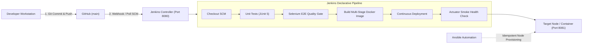

# 🏦 Secure CI/CD Pipeline for a Loan Application Tracking Portal

[]()
[]()
[]()
[]()
[]()
[]()
[]()
[]()

An enterprise-grade financial software portal designed to track, manage, and audit loan applications in real-time, backed by a fully automated, hardened, and observable **DevOps CI/CD delivery pipeline**.

---

## 📌 Table of Contents
- [Executive Overview](#-executive-overview)
- [End-to-End DevOps Architecture](#-end-to-end-devops-architecture)
- [Key Features (MVP)](#-key-features-mvp)
- [Port Isolation Matrix](#-port-isolation-matrix)
- [Technology Stack](#-technology-stack)
- [CI/CD Pipeline as Code (Jenkinsfile)](#-cicd-pipeline-as-code-jenkinsfile)
- [Automated Quality Gate (Selenium E2E)](#-automated-quality-gate-selenium-e2e)
- [Local Quick Start Guide](#-local-quick-start-guide)
- [Configuration Management & Reliability (Ansible)](#-configuration-management--reliability-ansible)
- [Documentation Index](#-documentation-index)

---

## 🚀 Executive Overview

Traditional retail loan processing suffers from opacity, long turnaround times, and lack of real-time visibility for borrowers and loan officers. 

This project solves these operational challenges by delivering:
1. **Application Layer:** A lightweight, high-performance web portal built with **Spring Boot 3.2**, **Thymeleaf**, and an embedded **H2 Database**, featuring live intake, interactive search, status drill-down timelines, and alerts for rejected loans.
2. **DevOps Delivery Layer:** Zero-touch automation utilizing **Git**, **Jenkins Declarative Pipelines**, **Headless Selenium WebDriver UI quality gates**, **Docker multi-stage containerization**, and **Ansible idempotent configuration management** with sub-15-second disaster recovery rollback.

---

## 🏗️ End-to-End DevOps Architecture



---

## 🌟 Key Features (MVP)

* **Intake & Auto-Generated ID:** Submits borrower applications with auto-generated reference IDs (`LOAN-1001`, `LOAN-1002`, etc.) and initializes immutable audit tracking.
* **Summary KPI Indicators:** 4 real-time dashboard counters calculating *Total Applications*, *In Intake / Review*, *Approved Loans*, and *Rejected / Exceptions*.
* **Searchable Dashboard:** Query loan records by Application ID or Applicant Name with instant filtering and reset controls.
* **Status Drill-Down & Audit Timeline:** Detailed applicant view with stage progression controls (`DOCUMENT_VERIFIED`, `UNDERWRITING`, `APPROVED`, `REJECTED`) and chronological timestamped event history.
* **Alerts & Exception Management (`/alerts`):** Dedicated queue displaying rejected applications with reason codes for high-priority review.
* **Automated Health Monitoring (`/actuator/health`):** Telemetry endpoint returning HTTP `200 OK` and `{ "status": "UP" }` for smoke testing and observability.

---

## 🔒 Port Isolation Matrix

To prevent port contention between the CI/CD controller and the deployed application:

| Port | Protocol | Purpose & Assignment | Host Mapping |
| :---: | :---: | :--- | :--- |
| **`8080`** | TCP | **Jenkins CI/CD Controller** *(Dedicated exclusively to Jenkins)* | Localhost / Intranet |
| **`8081`** | TCP | **Loan Application Tracking Portal** *(Application Runtime)* | `0.0.0.0:8081 -> 8081/tcp` |
| **`22`** | TCP | **SSH Administrative Access** | Secure Bastion |

---

## 🛠️ Technology Stack

| Layer | Technology | Version | Purpose |
| :--- | :--- | :--- | :--- |
| **Backend Framework** | Java OpenJDK / Spring Boot | 17 LTS / 3.2.3 | Core MVC architecture & REST APIs. |
| **UI Templating** | Thymeleaf + Bootstrap 5 | Latest | Server-side rendering with deterministic DOM IDs. |
| **Build Automation** | Apache Maven | 3.9+ | Compilation, dependency resolution, packaging. |
| **Database** | Embedded H2 Database | In-Memory | Zero-setup relational data persistence. |
| **CI/CD Server** | Jenkins (Pipeline as Code) | 2.440+ LTS | Automated checkout, build, testing, and deployment. |
| **Automated Testing**| JUnit 5 & Selenium WebDriver | 4.18+ | Regression test quality gate in Headless Chrome. |
| **Container Engine** | Docker | 24.0+ | Multi-stage image build, non-root security user (`appuser`). |
| **Config Management**| Ansible | 2.15+ | Agentless, idempotent YAML server provisioning. |

---

## 🔄 CI/CD Pipeline as Code (`Jenkinsfile`)

The pipeline enforces a 7-stage quality gate before code reaches the target environment:

```text
[1. Checkout] ──► [2. Unit Tests] ──► [3. Selenium Gate] ──► [4. Build Docker Image] ──► [5. Push Registry] ──► [6. Deploy Container] ──► [7. Health Check]
```

* **Quality Gate Abort:** If any JUnit or Selenium test fails, the pipeline aborts immediately, archiving failure screenshots in `target/screenshots/` and preventing faulty container deployment.
* **Parameterized:** Supports target environment selection (`DEV`, `STAGING`, `PROD`), host port (`8081`), and test execution flags.

---

## 🧪 Automated Quality Gate (Selenium E2E)

The automated UI test suite executes **4 critical user journeys** against Headless Chrome:
1. **Journey 1 (Intake):** Submits borrower form $\rightarrow$ verifies redirect and appearance of `LOAN-XXXX` ID on `/dashboard`.
2. **Journey 2 (Search):** Types query into search input $\rightarrow$ asserts table filters matching records.
3. **Journey 3 (Drill-Down):** Advances application status to `DOCUMENT_VERIFIED` $\rightarrow$ verifies audit timeline log.
4. **Journey 4 (Alerts):** Rejects application with reason code $\rightarrow$ verifies routing into `/alerts` queue.
* **Automated Failure Screenshots:** Captured via JUnit 5 `TestWatcher` callback into `target/screenshots/*.png`.

---

## 💻 Local Quick Start Guide

### Prerequisites
* Java JDK 17+
* Apache Maven 3.8+
* Docker Desktop (running)
* Git

### 1. Run Application Locally with Maven
```bash
# Clone the repository
git clone https://github.com/vickypukale/loan-application-tracking-portal.git
cd loan-application-tracking-portal

# Run automated tests (Unit + Selenium)
mvn clean test

# Launch the application on Port 8081
mvn spring-boot:run
```
Access the application at: **[http://localhost:8081/dashboard](http://localhost:8081/dashboard)**

---

### 2. Run Containerized with Docker
```bash
# Build multi-stage Docker image
docker build -t loan-portal:v1.0.0 -t loan-portal:latest .

# Run container with port mapping on Port 8081
docker run -d --name loan-portal-app -p 8081:8081 --restart unless-stopped loan-portal:v1.0.0

# Verify running container
docker ps -f name=loan-portal-app
```

---

## ⚙️ Configuration Management & Reliability (Ansible)

* **Server Specification:** Target baseline configured in [`docs/SERVER_CONFIGURATION_SPECIFICATION.md`](docs/SERVER_CONFIGURATION_SPECIFICATION.md).
* **Idempotency Proof:** Running the Ansible playbook twice demonstrates zero configuration drift (`changed=0, failed=0` on Run 2).
* **Sub-15 Second Rollback:** Automated rollback script restores the previous stable release (`loan-portal:v1.0.0`) in the event of an outage:
```powershell
powershell -ExecutionPolicy Bypass -File scripts\verify_reliability.ps1
```

---

## 📚 Documentation Index

| Documentation File | Description |
| :--- | :--- |
| 📖 [Final Technical Documentation](docs/FINAL_TECHNICAL_DOCUMENTATION.md) | Complete system architecture, component breakdown, port matrix, and troubleshooting guide. |
| 🎓 [Viva Defense & Exam Guide](docs/VIVA_DEFENSE_PREPARATION_GUIDE.md) | 5-minute live demonstration script, DORA metrics, and top 15 viva defense questions and answers. |
| 🛡️ [Task 14 Deliverable Report](docs/TASK_14_RELIABILITY_AND_ROLLBACK_DELIVERABLE.md) | Node specification, idempotency evidence, JSON health check, and rollback demonstration. |
| 🏦 [SBI Domain Expansion Roadmap](docs/FUTURE_ENHANCEMENTS_SBI_ROADMAP.md) | Phase 2 upgrade plan based on State Bank of India retail lending rules (CIBIL $\ge 750$, FOIR $\le 50\%$). |
| ⚙️ [Server Configuration Specification](docs/SERVER_CONFIGURATION_SPECIFICATION.md) | Prerequisite matrix for packages, users, folders, and firewall rules. |

---

## 👥 Author & Academic Credentials
* **Project Title:** Secure CI/CD Pipeline for a Loan Application Tracking Portal
* **Student / Lead Engineer:** Vicky Vilas Pukale
* **Repository:** [https://github.com/vickypukale/loan-application-tracking-portal](https://github.com/vickypukale/loan-application-tracking-portal)
* **Release Version:** `v2.0.0-final`
