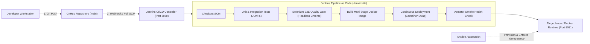

# Secure CI/CD Pipeline for a Loan Application Tracking Portal
## Final Technical Documentation & Architecture Reference

---

## 1. Executive Summary
The **Loan Application Tracking Portal** is an enterprise-grade financial software solution designed to streamline the loan intake, credit underwriting, status tracking, and exception management lifecycle. 

Coupled with a modern **DevOps delivery pipeline**, the project demonstrates zero-touch automation from code commit to container deployment, enforcing continuous integration, automated Selenium browser testing, containerized runtime isolation, and idempotent configuration management.

---

## 2. End-to-End Architecture & DevOps Flow

---

## 3. Technology Stack Breakdown

| Layer | Technology | Version | Key Responsibility |
| :--- | :--- | :--- | :--- |
| **Backend Runtime** | Java OpenJDK | 17 LTS | Core application programming language. |
| **Framework** | Spring Boot | 3.2.3 | Embedded web container, MVC routing, Data JPA persistence, Actuator health. |
| **Build & Dependency Tool** | Apache Maven | 3.9+ | Build lifecycle orchestration (`compile`, `test`, `package`). |
| **Database** | Embedded H2 | Runtime | Lightweight relational datastore with zero external setup friction. |
| **CI/CD Automation** | Jenkins | 2.440+ LTS | Pipeline as Code (`Jenkinsfile`) running on dedicated **Port 8080**. |
| **Quality Gate** | JUnit 5 & Selenium WebDriver | 4.18+ | Regression testing, headless UI user journeys, failure screenshot capture. |
| **Containerization** | Docker | 24.0+ | Multi-stage build, minimal Alpine JRE image, non-root system user (`appuser`). |
| **Configuration Management**| Ansible | 2.15+ | Declarative, agentless YAML automation enforcing server baseline and idempotency. |

---

## 4. Port Isolation Architecture

To guarantee zero port collision between the CI/CD server and the deployed application:
* **Port 8080:** Reserved **exclusively for the Jenkins Controller**.
* **Port 8081:** Dedicated **exclusively to the Loan Application Tracking Portal**:
  * Spring Boot properties: `server.port=8081`
  * Jenkins Pipeline target: `TARGET_PORT=8081`
  * Docker container host mapping: `-p 8081:8081`
  * Ansible firewall rule: UFW permits `8081/tcp`

---

## 5. Troubleshooting Guide

| Issue / Symptom | Probable Cause | Recommended Resolution |
| :--- | :--- | :--- |
| `Port 8081 was already in use` | A lingering Java or Docker process holds port 8081. | Run: `docker rm -f loan-portal-app` or in PowerShell: `Stop-Process -Id (Get-NetTCPConnection -LocalPort 8081).OwningProcess -Force`. |
| `Waiting for next available executor` in Jenkins | Previous build is still running or blocked. | Check Jenkins left sidebar under *Build Executor Status* and click `(X)` to abort the stuck build. |
| Selenium test fails during CI | UI element DOM ID changed or headless Chrome timed out. | Inspect failure screenshots archived in `target/screenshots/*.png`. |
| `Docker daemon is not running` | Docker Desktop engine is stopped or sleeping. | Start Docker Desktop from Windows Start menu; verify via `docker info`. |
| `ansible-playbook: not found` | Ansible attempted directly in Windows CMD. | Run inside the multi-arch runner: `docker run --rm -v "%cd%":/ansible my-ansible -i inventory.ini playbook.yml`. |

---

## 6. Project Limitations & Future Enhancements

### Limitations of Current MVP
1. **In-Memory Datastore:** Uses embedded H2; state resets upon container deletion unless a persistent host volume is mounted.
2. **Mock Identity Verification:** Does not connect to live external credit bureaus (Equifax/Experian).

### Phase 2: State Bank of India (SBI) Domain Upgrade
A detailed enhancement blueprint has been prepared in [`docs/FUTURE_ENHANCEMENTS_SBI_ROADMAP.md`](./FUTURE_ENHANCEMENTS_SBI_ROADMAP.md):
* **4-Pillar SBI Underwriting:** CIBIL Score ($\ge 750$), FOIR Debt-to-Income ($\le 50\%$), Age limits ($21–60$), and Monthly Salary ($\ge ₹25,000$).
* **Role-Based Access Control (RBAC):** Distinct `CUSTOMER`, `LOAN_OFFICER`, and `CREDIT_ANALYST` views.
* **Secure KYC Vault:** Magic-byte validated upload of PAN and Aadhaar cards with PII masking.
* **Automated Sanction Letters:** Dynamic PDF sanction generator upon loan approval.
